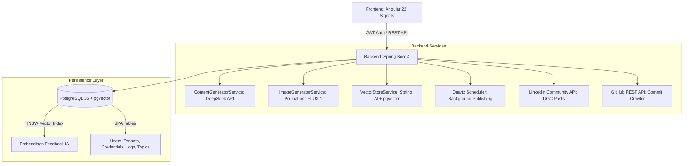

# 🚀 LinkedIn Automation SaaS — "Zero-Touch" Content Engine & Swipe Studio

[](https://www.oracle.com/java/)
[](https://spring.io/projects/spring-boot)
[-DD0031?style=for-the-badge&logo=angular&logoColor=white)](https://angular.dev/)
[](https://github.com/pgvector/pgvector)
[](https://www.deepseek.com/)
[](https://pollinations.ai/)
[](https://www.docker.com/)

Plataforma SaaS integral y multi-tenant para la **automatización inteligente de contenido profesional en LinkedIn**. Transforma la creación de contenido técnico de un panel aburrido a un **estudio interactivo tipo Swipe** con **aprendizaje continuo (RLHF)** impulsado por `pgvector` y generación visual HD con **FLUX.1**.

---

## 🌟 Características Principales

### 1. 🎯 Estudio de Contenido (Swipe Studio)
* **Generación de 3 Ángulos Estratégicos**: Por cada tema, el motor redacta 3 enfoques con personalidad:
  1. **Comparativa B2B (Estilo Consultora)**: Gancho dual `🔄`, desglose con viñetas `✅`, emojis estratégicos y complementariedad técnica (tipo *Blur Consulting*).
  2. **Storyteller / Caso Real**: Dolor y error en producción, diagnóstico técnico y aprendizaje clave.
  3. **Provocador & Debate**: Mito vs realidad, comparativa numerada `1️⃣ 2️⃣ 3️⃣` y preguntas para desatar comentarios.
* **Previsualización Realista LinkedIn Mobile**: Tarjeta interactiva con avatar, headline editable, fecha y métricas.
* **Editor al Vuelo & Métricas en Tiempo Real**: Ajusta el texto directamente, mide caracteres, legibilidad Flesch simplificada y estimación de costos en USD de tokens consumidos.
* **Banners Visuales Adaptables**: Selector de proporciones (`16:9`, `1:1`, `4:5`) con regeneración de semilla interactiva.

### 2. 🧠 Aprendizaje Continuo con `pgvector` (Vector Store)
* Cada acción en el Swipe Studio entrena a la IA:
  * **❤️ Me Gusta (+1)**: Genera embeddings semánticos y los persiste en PostgreSQL con índice HNSW y distancia coseno. En futuras publicaciones, la IA recupera tus posts más exitosos mediante `similaritySearch` para imitar tu voz.
  * **📌 Guardar Borrador (0)**: Almacena la versión para revisión manual sin sesgar el modelo.
  * **👎 No Me Gusta (-1)**: Si se acumulan rechazos consecutivos, el backend inyecta automáticamente restricciones negativas en el System Prompt para corregir el estilo.

### 3. 🖼️ Generación Visual HD con Pollinations AI (FLUX.1)
* **Cero Imágenes Estáticas**: Traduce dinámicamente el tema en un prompt fotográfico/3D en inglés.
* **Estética Glassmorphism 3D**: Renderizado isométrico, fondos oscuros `#0f172a`, nodos de datos en cian/púrpura brillante, iluminación de estudio y Octane render 8K.
* **Costo $0.00 USD**: Integración directa con el modelo **FLUX.1** sin necesidad de claves de pago de GPU.

### 4. 🔄 Pipeline de Ejecución en 2 Niveles de Prioridad
* **Prioridad 1 — Proyectos Reales (GitHub)**: Monitorea repositorios conectados, detecta commits recientes y genera publicaciones a partir del código real y sus diffs.
* **Prioridad 2 — Banco de Ideas Unificado**: Si no hay commits activos, consume temas del banco unificado:
  * 📌 *Temas Fijos Curados* (ideas puntuales con categoría y prioridad).
  * 🔍 *Investigación Abierta con IA* (palabras clave exploradas por el LLM).

### 5. ⏰ Programación Automática con Quartz Scheduler
* Programación de publicaciones mediante expresiones Cron multizona horaria (`America/Lima`, `America/Bogota`, `America/Mexico_City`, `Europe/Madrid`, etc.).
* Ejecución autónoma en segundo plano con control de errores y auditoría.

### 6. 🔐 Seguridad, Cifrado y Multi-Tenancy
* Autenticación sin estado con **Spring Security** y **Tokens JWT**.
* Aislamiento estricto de datos por `Tenant` (organización/usuario).
* **Cifrado AES-GCM**: Los tokens de acceso de LinkedIn y GitHub (PAT) se almacenan encriptados en la base de datos.

---

## 🏗️ Arquitectura del Sistema



---

## 📁 Estructura del Repositorio

```text
Post-Linkedin/
├── backend/                              # Servidor Spring Boot (Java 21/26)
│   ├── pom.xml                           # Dependencias (Spring AI, pgvector, Quartz, Security)
│   ├── src/main/java/com/deyvid/backend/
│   │   ├── config/                       # Configuración de Seguridad, VectorStore y WebClient
│   │   ├── controller/                   # Controladores REST (Auth, Users, Credentials, Repos, Publications, Schedules, Topics)
│   │   ├── dto/                          # Records de Request y Response
│   │   ├── entity/                       # Entidades JPA (User, Tenant, FeedbackIa, PublicationLog, etc.)
│   │   ├── repository/                   # Repositorios Spring Data JPA
│   │   ├── security/                     # Filtros JWT y UserDetailsService
│   │   └── service/                      # Lógica de negocio, IA, Pipeline y Quartz Jobs
│   └── src/main/resources/
│       ├── application.yml               # Configuración de base de datos, DeepSeek y Quartz
│       └── db/migration/                 # Migraciones Flyway (V1, V2, V3 con pgvector)
│
├── frontend/                             # Aplicación Web SPA (Angular 22)
│   ├── src/app/
│   │   ├── core/                         # Servicios HTTP, Guards, Interceptores y Modelos
│   │   ├── features/
│   │   │   ├── auth/                     # Login y Registro
│   │   │   ├── dashboard/                # Panel de métricas generales y estado de conexión
│   │   │   ├── studio/                   # Swipe Studio interactivo (3 versiones + IA)
│   │   │   ├── library/                  # Historial de auditoría y Banco de Ideas
│   │   │   ├── connections/              # Gestión de tokens LinkedIn y GitHub
│   │   │   └── settings/                 # Perfil, System Prompt, Horarios y Tema
│   │   ├── layout/                       # Layout con Drawer móvil responsivo
│   │   └── shared/                       # Sidebar, Header y componentes comunes
│   └── tailwind.config.js                # Configuración de Tailwind CSS y Dark Mode
│
├── docker-compose.yml                    # Contenedor PostgreSQL con extensión vector
└── postman_collection.json               # Colección de Postman completa (28 endpoints)
```

---

## 🚀 Guía de Instalación y Ejecución Local

### 📋 Requisitos Previos
* **Java Development Kit (JDK)**: Versión 21 o superior (ej. OpenJDK 21 / 26).
* **Node.js**: Versión 20 o superior y npm.
* **Docker & Docker Compose**: Para levantar PostgreSQL con `pgvector`.

---

### Paso 1: Iniciar la Base de Datos (Docker)
En la raíz del proyecto, ejecuta:
```bash
docker-compose up -d
```
> Esto iniciará PostgreSQL en el puerto **`5433`** (o `5432` según tu `docker-compose.yml`) con la extensión `vector` habilitada.

---

### Paso 2: Iniciar el Backend (Spring Boot)
1. Entra a la carpeta `backend`:
   ```powershell
   cd backend
   ```
2. *(Opcional en Windows si tienes múltiples JDKs)* Establece tu `JAVA_HOME` y ejecuta:
   ```powershell
   $env:JAVA_HOME="C:\Users\Deyvi\.jdks\openjdk-26.0.1"
   .\mvnw.cmd spring-boot:run
   ```
   *(En Linux/macOS: `./mvnw spring-boot:run`)*
3. El servidor backend estará listo en: **`http://localhost:8080`**.

---

### Paso 3: Iniciar el Frontend (Angular 22)
1. Abre una nueva terminal y entra a la carpeta `frontend`:
   ```powershell
   cd frontend
   ```
2. Instala dependencias y arranca el servidor:
   ```powershell
   npm install
   npm run dev
   ```
3. Abre tu navegador en: **`http://localhost:4200`**.

---

## 📬 Colección de APIs en Postman

El proyecto incluye el archivo [`postman_collection.json`](file:///c:/Users/Deyvi/Desktop/Guardar-Cosas/Dev/Post-Linkedin/postman_collection.json) listo para importar en Postman con **28 endpoints organizados**:

| # | Módulo | Endpoints Destacados |
|---|--------|----------------------|
| **01** | **Auth & Users** | `POST /auth/register`, `POST /auth/login`, `GET /users/me`, `PUT /users/me`, `DELETE /users/me` |
| **02** | **Credentials** | `GET /credentials/linkedin/status`, `POST /credentials/linkedin`, `PUT /credentials/linkedin`, `DELETE /credentials/linkedin`<br>`GET /credentials/github/status`, `POST /credentials/github`, `PUT /credentials/github`, `DELETE /credentials/github` |
| **03** | **GitHub Repos** | `GET /github/repos`, `GET /github/repos/:id`, `POST /github/repos`, `PUT /github/repos/:id`, `DELETE /github/repos/:id` |
| **04** | **Publications & Swipe Studio** | `GET /publications/swipe-batch`, `POST /publications/feedback` *(pgvector)*, `GET /publications/preview`, `PUT /publications/preview`, `POST /publications/trigger`, `GET /publications`, `GET /publications/:id`, `DELETE /publications/:id`, `DELETE /publications/history/clear` |
| **05** | **Schedules** | `GET /schedules`, `POST /schedules`, `DELETE /schedules/:id` |
| **06** | **Tenant & Dashboard** | `GET /tenant/profile`, `PUT /tenant/profile`, `GET /tenant/dashboard` |
| **07** | **Topics & Ideas** | `GET /topics/backup`, `POST /topics/backup`, `DELETE /topics/backup/:id`, `GET /topics/interests`, `POST /topics/interests`, `DELETE /topics/interests/:id` |

> ⚡ **Autenticación Automática**: Al ejecutar `1.1 Registro` o `1.2 Iniciar Sesión`, la colección captura y guarda automáticamente el token JWT en la variable `{{jwt_token}}` para todos los demás llamados.

---

## ⚙️ Variables de Entorno y Configuración (`application.yml`)

```yaml
spring:
  datasource:
    url: jdbc:postgresql://localhost:5433/linkedin_automation
    username: postgres
    password: password
  ai:
    openai:
      base-url: https://api.deepseek.com
      api-key: ${DEEPSEEK_API_KEY:tu_api_key_aqui}
      chat:
        options:
          model: deepseek-chat
    vectorstore:
      pgvector:
        index-type: HNSW
        distance-type: COSINE
        dimensions: 1536

security:
  jwt:
    secret: 404E635266556A586E3272357538782F413F4428472B4B6250645367566B5970
    expiration-ms: 86400000 # 24 Horas
  encryption:
    secret-key: TuClaveAES32BytesSuperSegura123!
```

---

## 🛠️ Tecnologías Utilizadas

* **Backend**: Spring Boot 3.4 / 4.0, Java 21, Spring AI (1.0.0-M6), Spring Security, Quartz Scheduler, Spring Data JPA, WebFlux (WebClient), Flyway, Lombok.
* **Frontend**: Angular 22 (Standalone Components, Signals, Computed properties, Reactive Forms), Tailwind CSS, Lucide Icons.
* **Inteligencia Artificial**: DeepSeek-V3 LLM, Pollinations AI (FLUX.1), PostgreSQL `pgvector`.
* **Seguridad**: JWT (JSON Web Tokens), BCrypt Password Hashing, AES-GCM Data Encryption.
* **Infraestructura**: Docker, Docker Compose, PostgreSQL 16.

---

## 👤 Autor

Desarrollado con dedicación por **Deyvid Jair Chupillon Silva**  
*Fullstack & Cloud AI Engineer*  
* GitHub: [@Deyvid0932](https://github.com/Deyvid0932)
* LinkedIn: [Deyvid Jair Chupillon Silva](https://linkedin.com)

---

## 📄 Licencia

Este proyecto está bajo la Licencia MIT. Puedes utilizarlo, modificarlo y distribuirlo libremente para fines personales o comerciales.
