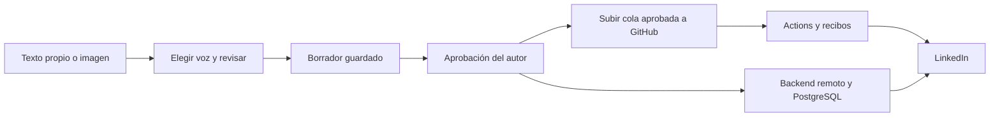

# AutoPost — contenido para LinkedIn

Aplicación Angular 22.2.1, Spring Boot 4.1.0 / Java 21 y PostgreSQL 16 para preparar, revisar y programar publicaciones. Docker y GitHub Actions permiten ejecutar las comprobaciones y publicar contenido aprobado.

## Flujo disponible

1. En **Crear publicación**, elige tono, público y objetivo antes de usar la IA.
2. Escribe manualmente, mejora tu texto o adjunta una imagen PNG/JPEG para pedir una propuesta a un proveedor con visión configurado.
3. Guarda un borrador para retomarlo, o aprueba el texto y la cuenta de destino.
4. Publica mediante una cola exportada en GitHub Actions, o mediante el backend con un servidor permanente. Usa una sola modalidad por cola.

**Si solo usas GitHub Actions**, puedes preparar contenido con la app local y subir la cola aprobada desde el editor a `automation/queue.json`, o descargarla para subirla manualmente. Actions publica después aunque tu PC esté apagada y conserva recibos en el repositorio. No actualiza automáticamente la base de datos local. La configuración y los pasos están en [DESPLIEGUE.md](docs/DESPLIEGUE.md).



## Desarrollo local

Necesitas Java 21, Node.js 24, Docker para PostgreSQL y Python 3 para los scripts de Actions. Configura los secretos reales fuera del repositorio; `.env.example` contiene sus nombres, sin credenciales. Haz coincidir el acceso PostgreSQL con tu entorno de desarrollo y usa `SCHEDULER_MODE=manual` si exportas a Actions.

```sh
docker compose up -d
```

En `backend`:

```sh
./mvnw spring-boot:run
./mvnw test
```

En Windows usa `mvnw.cmd` y configura `JAVA_HOME` para Java 21.

En `frontend`:

```sh
npm ci --ignore-scripts
npm start
npm test -- --watch=false
npm run build
```

Desde la raíz:

```sh
python -m unittest discover -s scripts/tests
```

Las pruebas con PostgreSQL usan una base aislada mediante `RUN_DB_TESTS=true` y variables `TEST_DB_*`. CI crea esa base efímera; nunca apuntes dichas pruebas a tus datos de producción.

## Seguridad y alcance

Las publicaciones requieren aprobación, respetan la cuenta elegida, pausa, simulación y cuota; los recibos impiden reintentos automáticos de resultados inciertos. Las claves JWT/AES son obligatorias, los códigos de recuperación se guardan como hash y los JWT anteriores se revocan al cambiar contraseña. Las imágenes tienen validación y los accesos de usuario se limitan al tenant correspondiente en los flujos corregidos.

El [informe de auditoría](docs/AUDITORIA.md) contiene los hallazgos, pruebas y pendientes, y la [guía de despliegue](docs/DESPLIEGUE.md) explica las migraciones y ambas modalidades de publicación.

Para conectar una cuenta personal de LinkedIn con OAuth, sincronizarla de forma cifrada con GitHub Actions y usar el calendario, sigue [LinkedIn OAuth y GitHub Actions](docs/LINKEDIN-OAUTH-ACTIONS.md).

El feedback conserva ejemplos del autor; no entrena un modelo mediante RLHF. El proveedor vectorial queda pendiente de una integración real de embeddings y la fuente GitHub heredada trabaja principalmente con mensajes de commits. No se prometen métricas de alcance o crecimiento sin datos reales.

El análisis de imagen necesita `VISION_BASE_URL`, `VISION_API_KEY` y `VISION_MODEL`. El proveedor de texto por sí solo no se considera capaz de analizar imágenes. Publicación y servicios de IA requieren credenciales, permisos y una prueba de integración real antes de activarlos.
